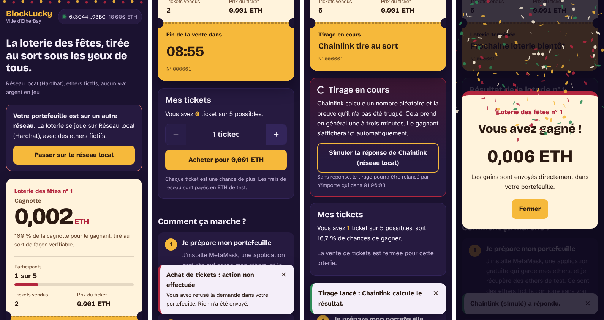
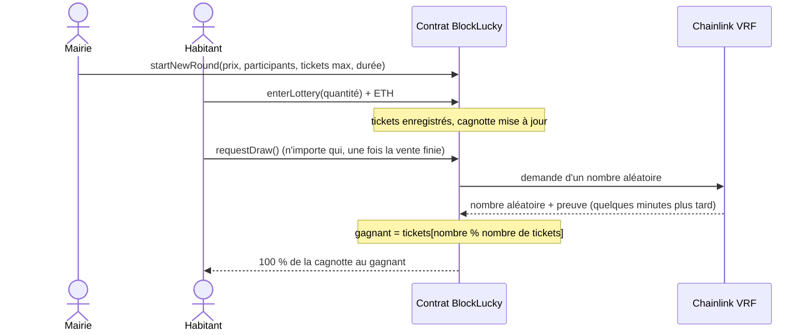

# BlockLucky : la loterie des fêtes d'EtherBay

La ville d'EtherBay organise sa loterie de fin d'année **sur la blockchain** : chaque habitant achète des
tickets, un gagnant est **tiré au sort de façon vérifiable** par Chainlink VRF et reçoit **100 % de la
cagnotte**. Tout est public : n'importe qui peut vérifier les tickets, le tirage et le paiement.

Projet réalisé en 48 h par une équipe d'Epitech Digital School pour la mairie d'EtherBay.
Il fonctionne sur **Sepolia**, le réseau de test d'Ethereum : les ethers utilisés sont fictifs.

| Mobile : achat, tirage, gagnant | Ordinateur : vue de la mairie |
|---|---|
|  |  |

---

## Sommaire

1. [Les règles](#les-règles)
2. [Pourquoi on peut faire confiance au tirage](#pourquoi-on-peut-faire-confiance-au-tirage)
3. [Installation](#installation)
4. [Commandes](#commandes)
5. [Démo locale complète](#démo-locale-complète)
6. [Déploiement sur Sepolia](#déploiement-sur-sepolia)
7. [Architecture](#architecture)
8. [Choix techniques](#choix-techniques)
9. [Limites et pistes futures](#limites-et-pistes-futures)

---

## Les règles

| | Démo | Vrai évènement |
|---|---|---|
| Prix du ticket | 0,001 ETH | réglable par la mairie |
| Tickets par portefeuille | 5 maximum | réglable |
| Fin de la vente | 5 participants **ou** 10 minutes | 10 000 participants **ou** le 31/12 |
| Gain | 100 % de la cagnotte | 100 % de la cagnotte |

- Chaque ticket est une entrée dans le tirage : les chances sont proportionnelles au nombre de tickets.
- Une fois la vente terminée, **n'importe qui** peut lancer le tirage, pas seulement la mairie.
- Si personne n'a joué, la loterie se ferme sans gagnant.
- La mairie peut seulement **ouvrir** une loterie et en choisir les règles. Elle ne peut **ni choisir le
  gagnant, ni toucher à la cagnotte**.

## Pourquoi on peut faire confiance au tirage

- **Le hasard vient de Chainlink VRF**, un service qui fournit un nombre aléatoire avec une preuve
  mathématique qu'il n'a pas été choisi. Ni la mairie, ni l'équipe, ni un mineur ne peuvent le prévoir.
- **Le programme est public et vérifié sur Etherscan** : chacun peut lire le code et suivre chaque ticket.
- **La mairie n'a aucun bouton secret** : un test automatique vérifie la liste exacte des actions possibles.
  Nous avons même écarté un composant Chainlink standard qui aurait permis au propriétaire de truquer le
  tirage (détails dans [docs/securite.md](docs/securite.md)).
- **La cagnotte ne peut pas rester bloquée** : si le gagnant ne peut pas recevoir l'argent, il lui est
  réservé ; si Chainlink ne répond pas, n'importe qui peut relancer le tirage au bout d'1 h.
- **43 tests automatiques, 100 % du code couvert**, analyse statique Slither sans faille.

👉 Le dossier complet pour le DSI : **[docs/securite.md](docs/securite.md)**.

---

## Installation

Prérequis : **Node.js 20.19 ou plus récent** (22 conseillé), npm, Git. MetaMask pour jouer.

```bash
git clone <url-du-dépôt>
```

```bash
cd blocklucky && npm install
```

```bash
npm --prefix frontend install
```

Pour Sepolia uniquement, créez votre fichier de configuration (jamais commité) :

```bash
cp .env.example .env
```

## Commandes

Toutes depuis le dossier `blocklucky/`.

| Commande | Rôle |
|---|---|
| `npm test` | Lance les 43 tests du contrat |
| `npm run coverage` | Mesure la couverture du code par les tests |
| `REPORT_GAS=true npm test` | Affiche le coût en gas de chaque fonction |
| `npm run demo:locale` | **Démo de secours en une commande** : blockchain locale, loterie ouverte et interface |
| `npm run node` | Démarre une blockchain locale |
| `npm run simulate` | Joue une loterie complète en local (5 habitants, tirage, gagnant) |
| `npm run deploy:local` | Déploie la loterie et un faux Chainlink en local |
| `npm run start-round:local` | Ouvre une loterie de démo en local |
| `npm run fulfill:local` | En local, fait répondre le faux Chainlink après un tirage |
| `npm run deploy:sepolia` | Déploie sur Sepolia ⚠️ voir le guide |
| `npm run start-round:sepolia` | Ouvre une loterie de démo sur Sepolia |
| `npm run frontend` | Lance l'interface sur http://localhost:5173 |

> Réseau d'école ou d'entreprise filtré ? Si Hardhat ne peut pas télécharger le compilateur,
> préfixez les commandes par `SOLC_LOCAL=1` (compilateur fourni par npm).

## Démo locale complète

Sans Internet ni ETH de test, c'est aussi la **démo de secours** de la soutenance.

1. Terminal 1 :

   ```bash
   npm run node
   ```

2. Terminal 2 :

   ```bash
   npm run deploy:local && npm run start-round:local
   ```

3. Terminal 3 :

   ```bash
   npm run frontend
   ```

4. Dans MetaMask : ajoutez le réseau `http://127.0.0.1:8545` (chainId `31337`) et importez un des comptes
   affichés dans le terminal 1. Le compte n°0 est la mairie.
5. Ouvrez http://localhost:5173, achetez des tickets avec plusieurs comptes, lancez le tirage, puis
   cliquez sur « Simuler la réponse de Chainlink ».

Tout cela en une seule commande : `npm run demo:locale` (Ctrl+C pour arrêter).
Version console : `npm run simulate`.

Préparation de la soutenance (vérifications, déroulé, questions du DSI) : [docs/soutenance.md](docs/soutenance.md).

## Déploiement sur Sepolia

Guide pas à pas (faucets, souscription Chainlink, consumer) : **[docs/deploiement-sepolia.md](docs/deploiement-sepolia.md)**.

| | |
|---|---|
| Adresse du contrat | *à compléter après le déploiement* |
| Code vérifié sur Etherscan | *lien à compléter* |
| Interface en ligne | *lien Vercel à compléter* |
| Coordinateur Chainlink VRF v2.5 | [`0x9DdfaCa8183c41ad55329BdeeD9F6A8d53168B1B`](https://sepolia.etherscan.io/address/0x9DdfaCa8183c41ad55329BdeeD9F6A8d53168B1B) |

Mise en ligne de l'interface sur Vercel : voir [frontend/README.md](frontend/README.md).

---

## Architecture

```
blocklucky/
├── contracts/
│   ├── BlockLucky.sol            le contrat de la loterie
│   └── test/                     contrats utilisés par les tests (gagnant qui refuse les ETH, attaquant…)
├── test/BlockLucky.test.js       43 tests
├── scripts/
│   ├── deploy.js                 déploiement local ou Sepolia, export vers l'interface
│   ├── startRound.js             ouverture d'une loterie de démo
│   ├── simulate.js               loterie complète en console
│   ├── fulfillLocal.js           réponse du faux Chainlink en local
│   └── lib/networkConfig.js      adresses Chainlink par réseau (sources citées)
├── frontend/                     interface React + Vite + ethers.js v6
│   └── src/
│       ├── hooks/useBlockLucky.js        portefeuille, lecture du contrat, événements, transactions
│       ├── components/                   billet, achat, tirage, gagnant, transparence…
│       └── contracts/                    ABI et adresses (générés par deploy.js)
└── docs/
    ├── securite.md               dossier sécurité pour le DSI
    ├── deploiement-sepolia.md    guide de déploiement
    ├── phase0-cadrage.md         versions vérifiées et pièges évités
    └── captures/                 captures d'écran
```

### Déroulé d'une loterie



### États du contrat

| État | Signification | Ce qui est possible |
|---|---|---|
| `CLOSED` | Aucune loterie en cours | La mairie ouvre une loterie |
| `OPEN` | Vente de tickets | Acheter ; lancer le tirage une fois la vente finie |
| `CALCULATING` | Tirage en attente de Chainlink | Attendre ; relancer après 1 h sans réponse |

### Coût en gas (mesuré)

| Action | Gas |
|---|---|
| Déploiement du contrat | ≈ 1 384 000 (2,3 % d'un bloc) |
| Ouvrir une loterie | 76 000 à 164 000 |
| Acheter des tickets | 97 000 (1 ticket) à 193 000 (5 tickets, premier achat) |
| Lancer le tirage | ≈ 184 000 |
| Réponse de Chainlink (désignation et paiement du gagnant) | ≈ 132 000 |

Aucune action ne dépend du nombre total de participants : le coût reste le même avec 10 000 joueurs.

## Choix techniques

| Brique | Choix | Pourquoi |
|---|---|---|
| Contrat | Solidity 0.8.24 | Protection native contre les dépassements de capacité |
| Framework | Hardhat 2.29.1 + toolbox 6.1.2 | Écosystème mûr, `solidity-coverage` compatible |
| Bibliothèques | OpenZeppelin 5.6.1 (`Ownable2Step`, `ReentrancyGuard`), Chainlink 1.4.0 | Composants audités. Chainlink 1.5.0 ne compile pas avec Hardhat 2 (voir [docs/phase0-cadrage.md](docs/phase0-cadrage.md)) |
| Hasard | Chainlink VRF v2.5 | Hasard à la fois imprévisible et vérifiable, standard du secteur ; jamais l'heure du bloc ni `prevrandao`, manipulables |
| Interface | React 19 + Vite 7 + ethers 6 | Léger, rapide, déployable sur Vercel |

## Limites et pistes futures

- **Argent réel :** passer sur le vrai réseau Ethereum demanderait une autorisation légale (Code de la
  sécurité intérieure, art. L322-1 et suivants, et Autorité nationale des jeux).
- **Âge et identité :** pour le vrai évènement, la vérification se ferait à l'inscription, hors blockchain.
- **Frais de réseau :** sur Ethereum, un achat peut coûter plusieurs euros de frais selon l'encombrement.
  Un réseau de « couche 2 » (Arbitrum, Base…), où Chainlink VRF est aussi disponible, coûterait bien
  moins cher, avec le même contrat.
- **Audit externe :** indispensable avant toute utilisation avec de l'argent réel.
- **Application mobile native :** le site est déjà pensé pour le mobile et fonctionne dans le navigateur
  de l'application MetaMask.

---

Licence MIT. Projet pédagogique : mairie d'EtherBay et Epitech Digital School.
